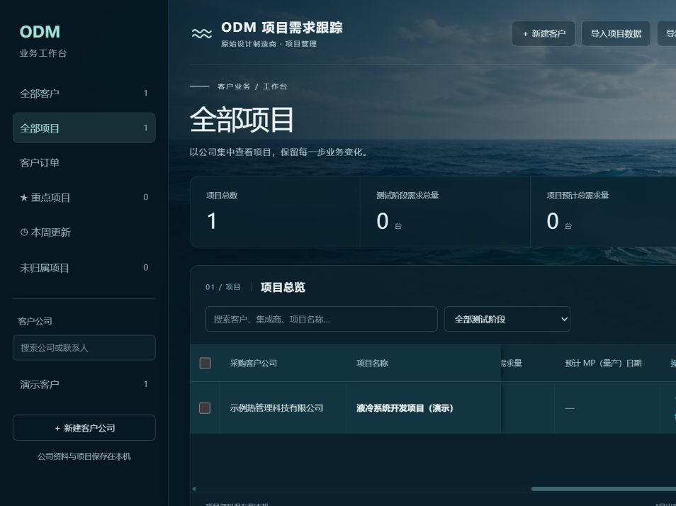

# 项目表固定采购公司及项目名称

日期：2026-10-26。需求：横向拖动项目开发表时，采购客户公司和项目名称持续可见。

## 调整

- 将项目名称移至采购客户公司旁，勾选框、公司和项目名称在左侧连续固定。
- 表头和数据共享列宽、固定偏移；深色背景遮住经过固定区的其他列，边界保留分隔阴影。
- 共用项目表覆盖全部项目、公司项目、未归属和重点项目。窄屏缩减固定列宽；长名称省略并提供完整名称悬停提示。
- 仅调整Vue模板与共享主题CSS，不修改业务接口、原始报告或数据库。

## 核对

使用临时演示数据库与合成客户，通过页面横向滚动前后读取实际布局：

| 状态 | 横向滚动距离 | 公司单元格左侧坐标 | 项目单元格左侧坐标 |
| --- | --- | --- | --- |
| 修改前，拉至最右 | 519.33px | -206.67px，已离开可见区 | 287.76px |
| 修改后，未滚动 | 0 | 312.67px | 492.67px |
| 修改后，拉至最右 | 973.33px | 312.67px | 492.67px |

修改后对应表头与数据的坐标、宽度一致；普通终端客户列随滚动移至-260.67px，而固定列位置不变。页面没有产生整页横向溢出。Vue生产构建通过（23模块），`git diff --check`通过。未增加或运行自动测试套件；以上是页面操作与布局核对，不宣称全套回归。

截图只包含合成资料；正式应用由前端自动更新，真实项目数据未修改。
