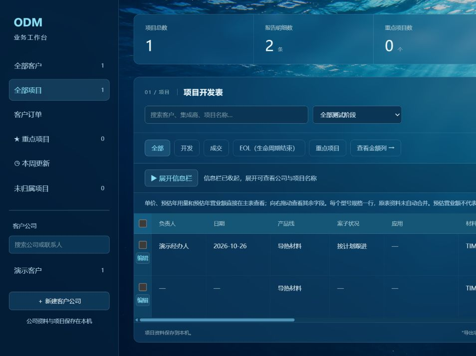
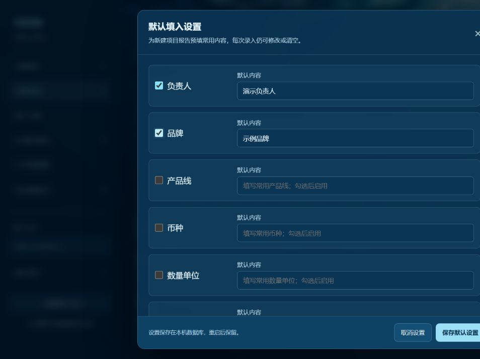

# 信息栏抽屉、默认填入与品牌

日期：2026-10-26。分支codex/report-ledger；基线147d733。

## 实现

- 采购公司、项目名称、终端客户可一起收起/展开，勾选编辑保持固定，浏览器记住选择；存储不可用时仍能本次切换。
- 六项本机持久默认值：负责人、品牌、产品线、币种、数量单位、计价说明。初始全关闭且为空，各项独立启停/修改，取消不保存。
- 新建报告先读取设置再初始化表单，允许当次修改/清空。后端仅POST补缺失字段，显式空串和PUT旧报告不补。原Excel导入、独立新增规格及订单不套用；设置更改不产生项目活动。
- 设置版本冲突409，白名单、长度、空启用、控制字符校验；重启保留。
- 品牌纳入旧报告元数据、独立规格、编辑及变更历史。Excel有品牌时在原18列末追加品牌列，原数字列位置不变，重新预览导入保留品牌。
- 修复创建返回版本因H2时间精度截断而立即编辑虚假409，改用规范化业务值哈希。实际数据变化仍拒绝旧版编辑。
- 独立审查无Critical/Important；异步新建时切换公司会改变归属的Minor已修复，发起时固定客户编号。

## 自动检查

全部写入检查使用临时H2及合成资料，正式库未写入演示资料。

| 检查 | 结果 |
| --- | --- |
| 默认值HTTP | 3项通过：初始/校验/版本、补齐/明确清空/停用/旧记录、品牌持久及重启 |
| 原报告HTTP | 5项通过 |
| 客户/规格/跟进HTTP | 14项通过 |
| 订单HTTP | 11项通过 |
| Flask | 57项通过，含4项工作簿检查及品牌重导入预览 |
| 启动与静态资源 | 14项通过 |
| Node辅助逻辑 | 预填、旧记录保护、收起列、存储降级通过 |
| Spring离线打包 | 通过，跳过Maven测试 |
| Vue生产构建 | 通过，28模块 |

RED→GREEN：默认接口初始404；创建后立即编辑虚假409；品牌导出初始18列。实现后均通过。

## 页面核对及限制

独立演示中点击收起，三列移除、勾选编辑仍固定并出现展开入口。启用负责人/品牌并保存，再打开新建表单，自动出现“演示负责人”和“示例品牌”。表单允许清空负责人及修改品牌并提交；随后页面项目数由1变2。后续具体值由HTTP检查覆盖，不声称最终单元格已经页面复验。

截图为合成资料。浏览器随后拒绝演示来源的下载与观察授权，因此实际浏览器下载、刷新后的抽屉状态及最终单元格未完成复验；没有换浏览器或通过HTTP等途径绕过。文件内容、设置重启、抽屉存储逻辑由已完成隔离检查覆盖。

正式应用升级前离线备份before-drawer-defaults-20261026-162357，已启动新版并通过状态及重复启动检查；没有预置合成负责人或品牌，真实默认设置由用户自行填写。演示服务已停止。

## 后续

AI截图识别/API Key仍在计划中。可让AI只返回变化字段，由本机补齐默认值并人工核对，减少重复文字；截图本身仍有识别消耗，不承诺固定token/费用下降比例。未调用AI或上传客户资料，未发布GitHub。
