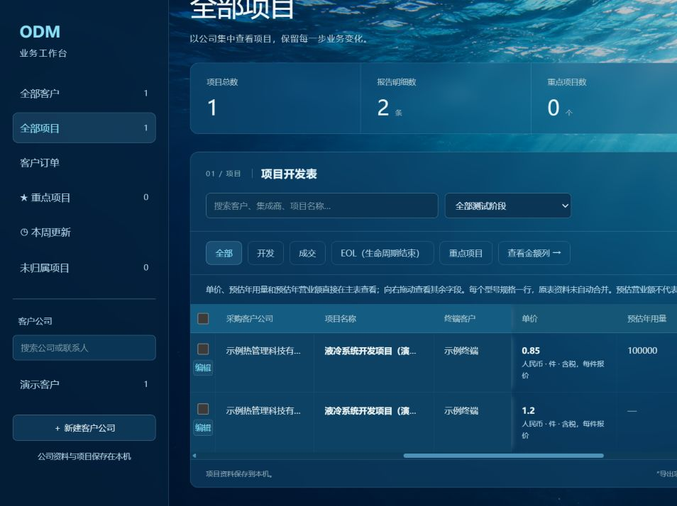
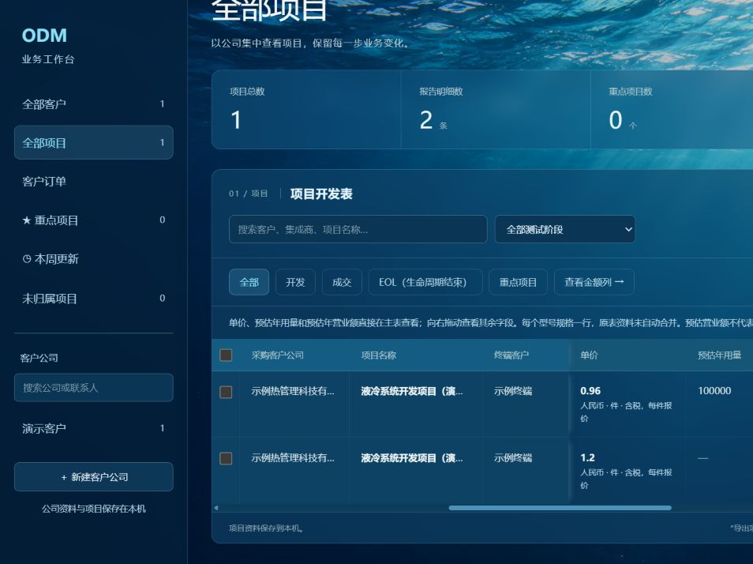

# 报告主表、Excel导出与启动稳定性验收

日期：2026-10-26。开发分支：codex/report-ledger。

## 范围

- 只读核对用户提供XLS的四工作表和18列表头；原始文件从未改写。界面沿用水下蓝色主题。
- Spring统一生成报告行：无明细旧项目读取原始报告资料，有活动明细时每型号规格一行。来源和未知元数据保留，不自动迁移合并。
- 采购公司、项目名称、终端客户紧凑固定；每行勾选框下方为“编辑”，打开集中编辑弹窗。横向滚动后入口仍可用；右侧不再重复放置。
- 开发、成交、EOL人工分类，重点独立标记；报价、预测与实际订单分开。修改公司/项目名称等共享字段会影响同项目其他行，编辑页有说明。
- 旧版并发编辑拒绝覆盖新修改；报告与明细更新保持事务。归档后保留项目恢复入口并隐藏归档报价。
- 下载四工作表XLSX，18列按原顺序；来源为同一个报告行接口，包含所有客户当前数据，不随列表筛选变化。不覆盖原XLS。

## 检查结果

写入检查均使用临时数据库及合成资料。真实库仅停机备份和只读核对，没有加入演示客户或订单。

| 检查 | 结果 |
| --- | --- |
| Spring离线打包 | 通过；跳过Maven测试，不计为自动测试 |
| Vue生产构建 | 通过，26模块 |
| 报告HTTP接口 | 5项通过：旧资料保留、分类、并发冲突、数值校验/事务、归档占位、客户文字及单位/币种/条款/阶段 |
| 订单HTTP回归 | 11项通过 |
| 客户资料/项目明细/跟进回归 | 14项通过 |
| 公司与本周更新工作流 | 1项通过 |
| Flask导入导出及目录 | 56项通过，含3项XLSX检查 |
| 启动/静态资源/恢复 | 14项通过 |
| 北京时间周边界 | 4项通过 |
| 合计 | 105项自动检查通过；页面检查另计 |
| 独立只读代码审查 | 原报告审查问题及两项启动Important均修复，最终未发现Critical/Important；审查不代替实际测试 |

报告用例先观察到404、归档行消失、客户文字恢复旧值及未建型号业务阶段丢失，修正后通过。工作簿高精度小数先出现显示精度损失，修正后保留原文字。启动新增缓存损坏及候选失败用例先失败，修正后通过。一次回归命令缺少测试参数、一次未设置Flask模块搜索路径导致测试未启动，按下述命令重跑全部通过，未作为产品缺陷计算。

## 页面与导出

1. 在隔离演示服务打开一个合成客户、一个项目、两个型号规格。
2. 集中编辑首行单价0.85→0.96、年预测营业额85000→96000，保存后主表显示一致，另一规格保持1.2。
3. 通过页面“导出项目表（Excel）”实际下载；读取文件核对开发/成交/EOL/重点项目四表、18列、两条规格，金额0.96/96000一致。
4. 追加按钮位置要求后，重新建立合成演示，确认每行“编辑”在勾选框下；向右滚动定位金额后仍可打开对应TIM-A1行并取消。第二轮合成数据重新初始化，因此截图显示原演示报价0.85。





截图均为合成数据。下载的验收工作簿仅在本机下载目录，不纳入源码仓库。

## 启动稳定性

升级期间出现打不开和构建产物占用，启动入口现改为：

- 日常Vue使用已构建静态资源，由已有Python提供本地服务；Vite用于开发。
- JAR及前端资源按内容哈希复制到logs/runtime独立快照，构建不改写运行中的文件。运行快照不包含H2数据库。
- 互斥锁防止并发启动；进程状态原子保存。停止前校验PID、创建时间及已知可执行文件，兼容旧Node前端状态；未知进程和端口占用保留并提示。
- 同时检查数据库可写、Flask统计和前端身份/网页资源，全部就绪后才报告成功；重复启动正常应用不重复建进程。
- 损坏构建可使用上次健康快照。有效但启动失败的新候选清理自有进程并保存失败日志，最多恢复一次旧健康版本，同一版本不循环尝试。
- 前端缓存缺资源时从完整构建复制新缓存；首次安装没有可用构建和历史快照时明确报错。
- 新增check-app.cmd及repair-app.cmd；原桌面快捷方式继续指向start-app.cmd。

实测停止、启动、状态、重复启动均成功。正式应用使用快照运行时再次Maven打包及Vue构建成功，应用健康检查仍正常，解决原JAR占用问题。最终版再次停机备份后启动。备份保存在忽略目录backend/springboot/data/backups，未提交业务数据。

最终备份目录：before-report-final-20261026-160033。启动后只读核对85个项目、85条报告行、81条有报价，与升级前一致；正式页面已加载新构建，左侧固定编辑入口和Excel导出入口均出现。正式应用保持运行，隔离演示服务已停止。

本机制提供启动时修复，不提供持续后台监控。运行快照不是数据库备份，也不能逆转不兼容的数据库迁移；后续结构升级仍需停机备份。运行缓存目前不自动清理历史版本。

## 复现命令

在仓库根目录、已安装环境中运行；HTTP用例创建临时H2，不能改为正式数据库路径。

```powershell
. ./environment.ps1
$env:PYTHONUTF8='1'
mvn.cmd -o -f backend/springboot/pom.xml package '-Dmaven.test.skip=true' -q
npm.cmd --prefix frontend run build
python backend/tests/verify_report_ledger.py --java "$env:JAVA_HOME/bin/java.exe" --jar "$PWD/backend/springboot/target/odm-tracker-1.0.0.jar"
python backend/tests/verify_sales_orders.py --java "$env:JAVA_HOME/bin/java.exe" --jar "$PWD/backend/springboot/target/odm-tracker-1.0.0.jar"
python backend/tests/verify_workspace_extensions.py --java "$env:JAVA_HOME/bin/java.exe" --jar "$PWD/backend/springboot/target/odm-tracker-1.0.0.jar"
python backend/tests/verify_company_weekly.py --java "$env:JAVA_HOME/bin/java.exe" --jar "$PWD/backend/springboot/target/odm-tracker-1.0.0.jar"
$env:PYTHONPATH=Join-Path $PWD 'backend/flask'
python -m unittest discover -s backend/flask/tests -q
python -m unittest discover -s backend/tests -p 'test_*.py' -q
javac -encoding UTF-8 -cp backend/springboot/target/classes -d work/company-weekly backend/tests/WeekBoundaryCheck.java
java -cp 'work/company-weekly;backend/springboot/target/classes' WeekBoundaryCheck
python manage.py status
```

## 边界与后续

- XLSX包含当前报价和需求预测，不是实际订单/交货/收款台账。重点表会重复显示重点行，不可跨四表重复求和。
- 非数值、超15位有效数字或超6位小数的原始值保留文字，避免Excel显示舍入；非法控制字符和过长单元格明确拒绝，不静默截断。文本不执行公式。
- 不承诺恢复用户原XLS所有格式、公式、合并单元格或打印布局。原始报告保持不变。
- 自动匹配更新导入、旧数据自动合并、交货收款、Word模板填写、截图识别、AI API仍在后续计划。
- 当前为本地开发版本，未推送或发布GitHub。
