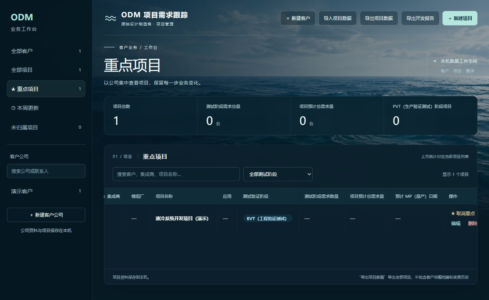

# 客户与项目新增功能回归、重点项目

日期：2026-10-26；基线 daccf3c。

## 发现和修复

1. 客户经办/审批日期允许公元0000年。新增检查实际得到200而非400；定位到Java LocalDate允许年0。现限制为1至9999年，失败用例修复后通过。
2. 原HTTP测试脚本使用固定18083端口，仅凭健康响应判断新实例已就绪，可能误认已有服务。无关只读健康探针复现其被访问1次；现由系统分配端口，从本次子进程独有日志获取端口并校验进程存活，探针请求数为0。重启先清空旧日志；清理只停止自身进程。

## 检查结果

| 范围 | 结果 |
| --- | --- |
| Flask导入、导出、客户文件夹 | 53项通过 |
| 既有公司工作台完整HTTP流程 | 1项流程通过（含多条断言） |
| 客户资料、型号规格、跟进、重点及隔离 | 14项通过 |
| 北京时间周一/跨年边界 | 4项通过 |
| Vue生产构建、Spring Boot打包 | 通过 |
| 独立只读代码审查及修复复核 | 未发现未解决的重要阻断 |

新增回归覆盖：客户资料省略保留/部分合并/清空及错误回滚；枚举、长度和日期校验；长项目型号规格与超过4000字历史；精确十进制、空与0及无修改保存；跨项目引用、归档恢复；阶段前后快照与改名后的历史；失败跟进回滚阶段；整批删除保护；并发重复新增/新增与删除；数据库重启持久化；重点独立性及旧表单兼容。

运行命令（先加载本地环境）：

```powershell
python -m unittest discover -s tests -v  # 在 backend/flask 目录
python backend/tests/verify_company_weekly.py --java <java.exe> --jar <built.jar> -v
python backend/tests/verify_workspace_extensions.py --java <java.exe> --jar <built.jar> -v
```

测试使用合成资料和临时H2，客户文件服务指向不可用本地端口，不创建真实桌面目录；没有将测试客户或项目写入正式库。正式库升级前离线备份。

## 重点项目功能

项目独立标记，不改变所属公司、测试阶段、明细或订单。左侧重点列表使用原项目编号过滤，列表统计不重复计算。实际标记/取消进入本周更新，重复操作不新增审计。旧项目默认非重点，不伪造历史时间。

页面检查（合成数据）：标记前重点0/全部1；标记后重点1/全部1；取消后重点0/全部1并显示空状态。截图保留在同目录。



这些检查覆盖已列出的范围，不能保证所有环境、浏览器和业务异常都已覆盖。订单、交货、收款及尚未实现的AI/Word功能不在本记录验收范围内。
