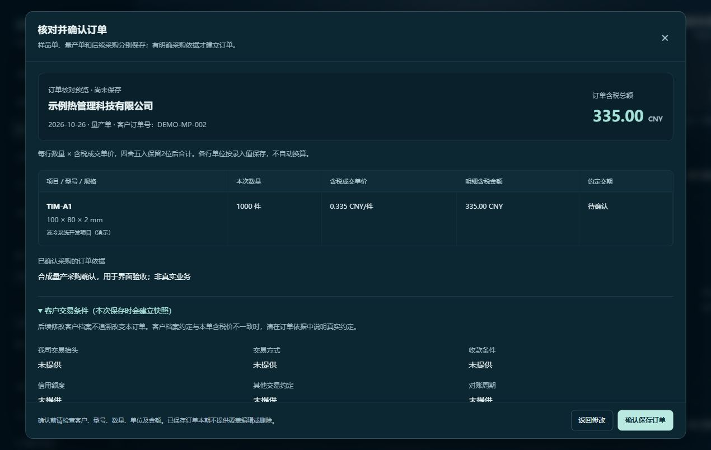
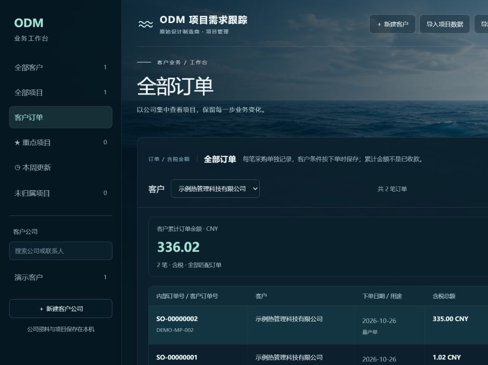

# 订单登记与客户累计金额验收

日期：2026-10-26。开发分支：`codex/sales-orders`，实现基线：`6909f4c`。

## 已实现范围

- 客户下样品、量产及复购分别建单；一单同项目多条型号规格。
- 手动确认日期、币种、实际数量、单位、含税成交单价及订单依据，报价只作参考。
- 每行数量×单价按HALF_UP保留2位，再合计订单；客户按币种分别累计全部匹配订单，不仅当前页。接口以字符串传输金额，避免浮点误差。
- 预览不写入；确认时重新校验资料及归属。预览后客户条款、项目或型号规格变化需重新核对。
- 客户名称、长期交易条件、项目名称和规格按下单时保存快照。幂等请求及同客户订单号重复保护；保存订单、明细和变更记录保持同一事务。
- 全局与公司内订单列表、详情、分页、按客户导出CSV；订单新增进入公司/本周变更。
- 修正预览保留旧滚动位置的问题；预览切换后回到顶部。CSV每单总额仅首行出现，避免多明细重复汇总。

## 检查结果

所有写入检查使用临时H2数据库及合成资料；未给正式业务库加入演示客户或订单。

| 检查 | 结果 | 主要覆盖 |
| --- | --- | --- |
| Spring Boot离线打包 | 通过 | 生产代码编译与打包；Maven跳过测试，不将其算作自动测试 |
| Vue生产构建 | 通过，23模块 | 订单组件及已有页面编译 |
| `verify_sales_orders.py` | 11项通过 | 精度、逐行舍入、分币种全量汇总、零写入预览、过期预览、归属归档、重复订单、并发幂等、快照、CSV、重启保留 |
| `verify_workspace_extensions.py` | 14项通过 | 客户资料、项目明细、跟进、重点、并发保护及临时服务隔离 |
| `verify_company_weekly.py` | 1项工作流通过 | 公司、项目归属及本周更新 |
| Flask unittest | 53项通过 | 既有导入、导出及相关接口回归 |
| `WeekBoundaryCheck` | 4项通过 | 北京时间周边界 |
| 独立订单代码审查 | 无阻断项 | 金额、快照、事务、幂等、归属、CSV和界面异步兼容 |

TDD记录：订单预览接口未实现时用例返回404；CSV总额仅首行用例先失败，修正后通过。不是将只通过一次的测试声称为完整红绿循环。

### 复现命令

在已配置环境的仓库根目录运行，各命令退出码应为0：

```powershell
. ./environment.ps1
$env:PYTHONUTF8='1'
mvn.cmd -o -f backend/springboot/pom.xml package '-Dmaven.test.skip=true' -q
npm.cmd --prefix frontend run build
python backend/tests/verify_sales_orders.py --java "$env:JAVA_HOME/bin/java.exe" --jar "$PWD/backend/springboot/target/odm-tracker-1.0.0.jar" -v
python backend/tests/verify_workspace_extensions.py --java "$env:JAVA_HOME/bin/java.exe" --jar "$PWD/backend/springboot/target/odm-tracker-1.0.0.jar"
python backend/tests/verify_company_weekly.py --java "$env:JAVA_HOME/bin/java.exe" --jar "$PWD/backend/springboot/target/odm-tracker-1.0.0.jar"
javac -encoding UTF-8 -cp backend/springboot/target/classes -d work/company-weekly backend/tests/WeekBoundaryCheck.java
java -cp 'work/company-weekly;backend/springboot/target/classes' WeekBoundaryCheck
Push-Location backend/flask
python -m unittest discover -s tests -q
Pop-Location
```

## 页面验收

在隔离演示服务中通过实际页面创建两笔合成订单：

1. 样品单两行：3×0.335=1.01，1×0.005=0.01，订单1.02 CNY。
2. 量产单一行：1000×0.335=335.00 CNY。
3. 客户筛选后的累计336.02 CNY，共2笔；公司页显示相同订单和累计，变更记录可返回客户及订单。
4. 预览页展示明细金额、客户条款和缺失项；资料缺失保持“未提供”，没有猜填。





截图均为合成业务示例，不包含真实客户资料。

## 当前限制及下一步

- 当前一张订单限同一项目；跨项目订单规则尚待确认。
- 确认后的订单只读。尚无编辑、删除、作废、退款或退货入口，确认前需检查。
- 本期尚无实际交货和收款台账；保存量产单不自动改变项目或明细阶段。
- 订单CSV是明细导出，不包含完整客户档案、条款快照和全部变更历史，不能替代停机数据库备份；附件和客户文件夹需另行备份。
- 本轮仅本地保存；未推送GitHub或发布新版本。正式升级备份及运行结果见执行计划末尾记录。
