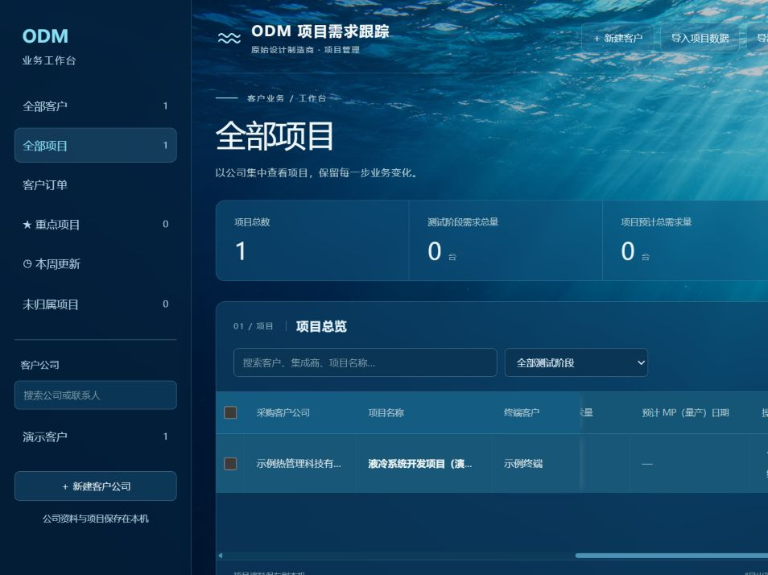

# 水下透光主题与紧凑固定列

日期：2026-10-26。接续用户要求：终端客户也固定；按新参考图采用水下青蓝光束和通透面板；减少三列固定区占用。

## 实现

- 固定勾选框、采购客户公司、项目名称及终端客户；所有项目视图共用。
- 桌面宽度依次36、140、170、110px，共456px，相比本轮收窄前同口径592px减少约23%。窄屏按断点进一步收窄，长名称省略并保留完整title提示。
- 固定单元格使用同色实底，普通面板为蓝色64%不透明度及12px背景模糊；水下光束背景和浅色文字沿用最新图片参考。
- 修正收窄勾选框产生的省略号和主题切换后固定行悬停底色不匹配的问题。
- 背景保存为 `frontend/public/images/underwater-workspace-v2.png`，旧海面资源保留。背景是本地静态图片，无运行时外部图片请求。
- 同步前端AGENTS、视觉规范及开发进度，避免后续开发恢复旧配色。

## 页面核对

在隔离数据库的合成客户页面，通过真实横向滚动查看：从0滚动到837.33px时，四个固定单元格左侧坐标始终为270.67、306.67、446.67、616.67px；各宽度为36、140、170、110px，表头与数据一致，页面无整页横向溢出。

另查看新建项目弹窗：输入框、文字、边框、日期入口及保存/取消按钮可读；未保存演示项目。正式业务库未写入本次演示数据。

Vue生产构建通过（23模块），`git diff --check`通过。本轮仅前端样式、固定列和静态资源调整，未新增或运行自动测试套件；页面核对不等同完整回归，也未声称已在手机设备上验收。

## 背景素材生成

使用内置imagegen，原图未裁改或进行像素编辑。用户截图仅作为色彩、光束和水下氛围参考，未复刻其中的文字或社交界面。

最终提示：

Use case: photorealistic-natural. Asset type: wide website background for a Chinese business dashboard. Create a cinematic realistic underwater ocean photograph, seen from below the water surface looking horizontally into clear open water. Dappled gently rippling surface across the upper edge. Bright natural cyan-blue sunbeams enter diagonally from the upper right and fan down toward the center. Rich clear marine blue and azure midtones, dark navy lower left and bottom, luminous turquoise on the upper right. Calm translucent water and atmospheric depth, subtle drifting tiny particles, subtle distant small fish silhouettes only on the far right. Broad quiet dark blue negative space on the left and lower center to sit behind readable business tables. Wide landscape composition 16:9. Only the underwater photograph, edge-to-edge. No typography, words, logos, watermark, interface, phone frame, buttons, people, divers, boats, sea floor, coral or decoration. Original artwork inspired by the user's underwater light mood reference; do not reproduce its layout or text.
