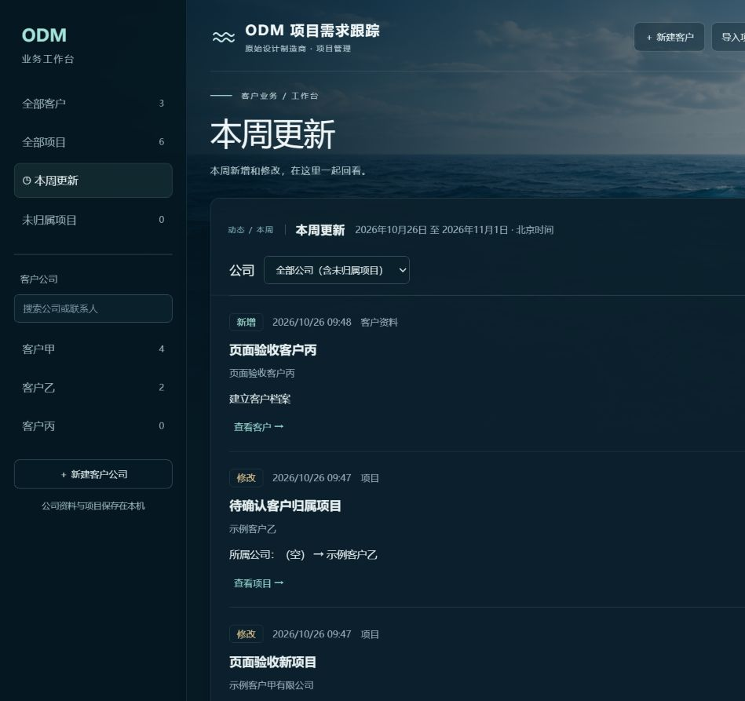

# 公司工作台与本周更新验收

日期：2026-10-26。数据范围：独立端口、临时H2数据库、临时桌面目录和合成客户；正式库仅进行升级前后只读核对。

## 已实现

- 客户基本资料和固定客户编号；实际采购公司与终端客户分别记录。
- 左侧全部客户、全部项目、本周更新、未归属项目，以及公司快捷入口。
- 公司页面集中显示基本资料、所属项目和逐次修改历史；可新增公司项目、编辑客户及检查/重试桌面文件夹。
- 勾选项目后指定或移除客户归属；切换公司、视图、搜索或阶段筛选时清除旧勾选。
- 按北京时间周一00:00至下周一00:00查看新增及实际修改，显示字段变化、当时名称快照、公司筛选、分页和原记录入口。
- 旧项目不虚构新增/修改时间；未确定公司先保留未归属，原表客户仅供人工核对和搜索。
- 表格导入支持人工选择采购公司，客户编号参与重复判断；项目导出保留实际客户名称作为重导入候选。

## 验证证据

| 检查 | 结果与边界 |
| --- | --- |
| Flask单元与导入回归 | 53项通过，包含客户目录归属、重复请求、目录冲突、改名、非法客户编号、导出再预览及旧表格兼容 |
| Spring Boot独立HTTP工作流 | 通过：客户重名拒绝、公司项目筛选、无变化不写日志、伪造审计时间无效、批量归属错误整批回滚、客户转移快照、删除后保留历史、分页参数校验、目录失败可重试 |
| 空字段回归 | 先复现旧项目null被前端转成空字符串后产生假更新；修正后同一工作流通过。页面原样保存也未增加历史数 |
| 北京时间周界限 | 4个独立Java断言通过，覆盖周日前后、周一边界及跨年 |
| 旧H2迁移与重启 | 用旧版JAR创建真实旧结构后升级；历史项目时间保持空，不写虚假事件；重启后客户、项目和变更记录仍在 |
| 全流程预览 | 临时桌面实际创建客户文件夹；公司改名保留原路径；重复导入跳过且无新事件；客户端原样保存无事件 |
| 浏览器操作 | 公司内新建项目默认归属正确；页面新增与字段修改出现在历史和本周列表；勾选项目统一归属；公司筛选只显示目标公司；页面新建客户自动创建临时桌面目录 |
| 布局与控制台 | 已检查桌面及390像素窄屏；窄屏导航可展开/收起，页面无整体横向溢出；已查看控制台无错误/警告 |
| 构建 | Vue生产构建成功，Spring Boot离线打包成功；Maven未运行JUnit，后端行为由独立HTTP和Java断言验证 |
| 正式数据保护 | 离线备份已建立；升级前85条、升级后85条，原有字段逐项一致；正式客户数0、新变更事件数0，未混入模拟客户/项目 |

合成数据截图：

## 运行与后续

正式入口仍为 `start-app.cmd`，停止入口 `stop-app.cmd`，地址 `http://127.0.0.1:5173/`。原有85条项目需人工确认采购公司后归属；不根据终端、ODM或模组厂猜客户。

客户完整备案和交易条件、订单/多型号规格、业务跟进内容、Word/PDF处理、截图识别与AI API仍按后续计划实施。本轮字段变化记录不等同于完整销售跟进或订单系统。项目CSV不包含客户完整档案和全部历史；完整数据仍需按离线数据库及客户目录备份流程保留。
