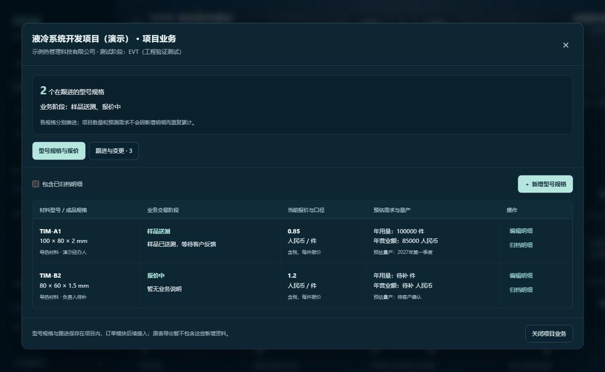
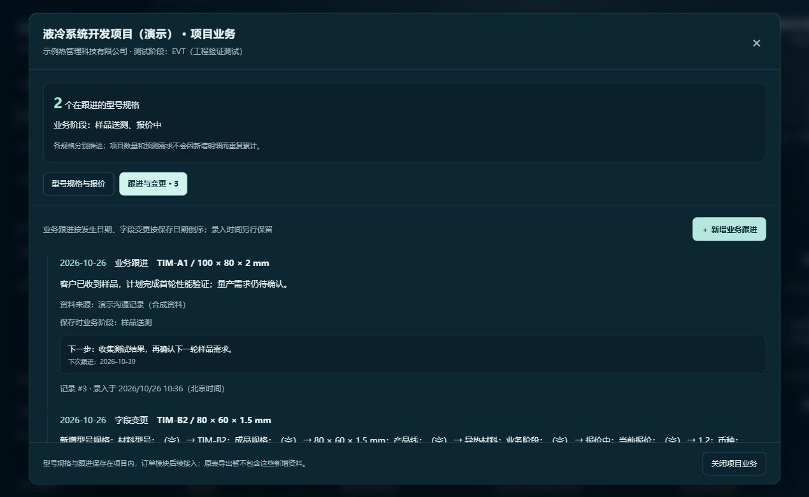

# 项目型号规格与业务跟进

日期：2026-10-26；基线：`7b987a5`；分支：`codex/project-details-followups`。

## 新增能力

1. 在项目列表点击“规格与跟进”进入业务详情。多条材料型号/规格分别维护产品线、负责人、报价、币种、单位、含税计价说明、需求预测、量产预估、竞争对手及备注。
2. 明细业务阶段使用 PRD 的七种状态：报价中、样品送测、NPI（新产品导入）、验证通过待量产、下单量产、验证失败结案、项目取消。未确认留空。EVT/DVT/PVT继续保存在原项目测试阶段。
3. 报价与预测使用 `BigDecimal(19,6)`，最多13位整数和6位小数；输出JSON字符串，前端不以浮点数转换金额。营业额手工填写，不做未经确认的单位换算或金额计算。
4. 跟进可关联项目或某条未归档明细，保存实际发生日期、原内容、来源说明、下一步计划和下次日期。可明确选择同步修改明细业务阶段，同事务保存阶段前后值；不自动生成真实订单。
5. 直接编辑明细时自动保存字段变更历史，包含旧报价、新报价等前后值。系统变更按北京时间实际保存日记录，人工跟进按填写的发生日期记录；录入时间另行保留。
6. 历史只追加，按日期及编号倒序分页。型号或规格改名后，旧跟进仍保留原快照。误录可新增更正说明，不能覆盖旧记录。
7. 明细归档/恢复均保留历史；有明细（含归档）或跟进的项目禁止删除。整批删除先检查全部目标，任一目标受保护则整批不删。
8. 项目修改、归属、删除和明细/跟进写入共用项目行写锁；批量按固定顺序取锁。型号规格新增检查也在项目锁内，防止并发重复建同一型号规格。

## 数据和接口

新增 JPA 表 `project_details`、`project_followups`，通过稳定项目编号关联；旧项目及原 `reportData` 保留，不自动创建明细，不猜测原报告行应当如何合并。

| 方法 | 路径 | 用途 |
| --- | --- | --- |
| GET | `/api/projects/detail-options` | 业务阶段选项 |
| GET / POST | `/api/projects/{projectId}/details` | 明细列表 / 新增 |
| PUT | `/api/projects/{projectId}/details/{id}` | 完整更新该明细的可编辑字段 |
| POST | `/api/projects/{projectId}/details/{id}/archive` | `{ "archived": true/false }` 归档或恢复 |
| GET | `/api/projects/{projectId}/followups?page=0&size=20` | 跟进及字段变更历史，size最大100 |
| POST | `/api/projects/{projectId}/followups` | 追加人工跟进，可含 `newBusinessStage` |

人工跟进字段：`detailId`（可空表示项目整体）、`contactDate`、`content`、`source`、`nextAction`、`nextContactDate`、`newBusinessStage`（留空表示保留当前阶段）。内容、来源和发生日期必填。接口不允许由客户端指定历史ID、系统时间或快照。

`kind=COMMUNICATION` 为人工跟进，`FIELD_CHANGE` 为系统字段变化；扩展审计类型 `DETAIL`、`FOLLOWUP`，仍能从本周更新跳转到所属项目。明细当前报价与之后订单成交价格将分别保存。

## 构建、审查和页面记录

- Maven离线打包成功，显式 `-Dmaven.test.skip=true`；未运行测试。
- Vite生产构建成功，20个模块；没有新增依赖。
- 独立静态审查发现的审计标题长度和并发删除缺口已修正并复核。
- 为页面展示，在隔离临时数据库建立合成客户、一个项目、两个独立阶段的型号规格和一次沟通；读取并展示了系统字段留痕。演示客户不创建正式桌面目录，不接触真实业务资料。
- 正式应用升级前保存H2离线备份，随后启动新版；演示数据不写入正式数据库。
- 没有新增或运行自动测试；本轮没有覆盖所有错误路径、重启持久化、批量回滚、并发及旧功能回归，不能视为完整业务验收。

## 尚未实现

独立样品/量产订单及交货收款、重点标记、报告分类、明细在原18列报告中的导入导出映射、截图附件和AI识别。原CSV仍只导出旧项目与原报告资料，不包含新明细和跟进；完整保存需要备份本地数据库。

下一步继续订单部分，先确认会影响金额的币种、单位、含税及舍入口径，避免将未确认规则写入正式订单计算。
