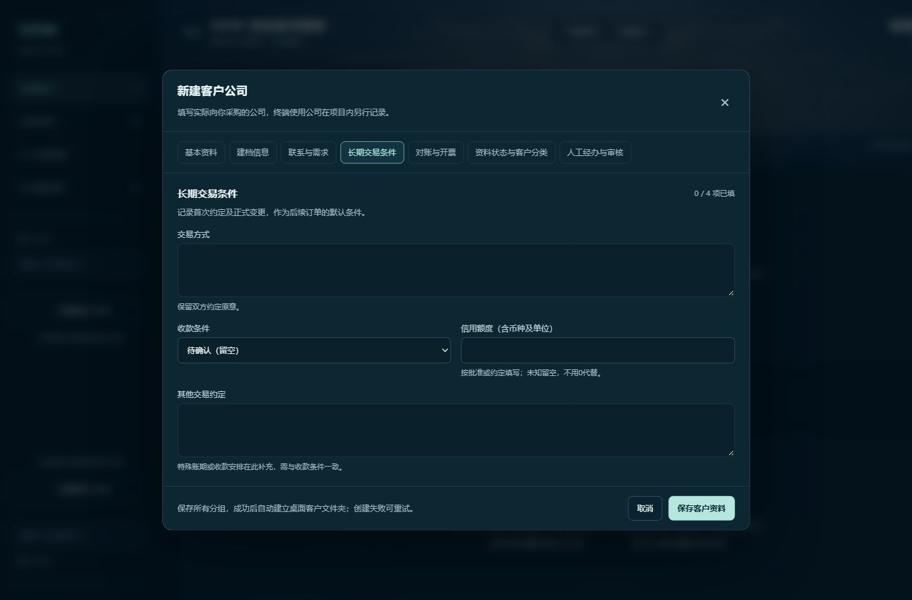

# 客户备案与长期交易条件实现记录

日期：2026-10-26
基线：v1.1.0 / ad7663b
范围：路线图阶段 B 的客户备案字段与长期交易条件。尚未发布新版本。

## 当前实现

- 保留原公司全称、简称、联系人、联系方式、备注以及桌面目录。
- 新增30项扩展资料，按建档信息、联系与需求、长期交易条件、对账开票、资料状态与分类、人工经办审核分组。
- 客户全称仍是唯一必填项。未知的含税、资料状态、合同情况不自动视为否或无；信用额度保留金额、币种与单位原文。
- 经办日期、审批、核准、客户评级无自动默认值，由人工填写。
- 保存扩展资料的差异复用同事务变更记录，可在本周更新查看字段前后值；内容不变不产生新变更。
- 客户表单按分组切换，底部统一保存所有分组；公司资料页可展开查看各组，默认展示交易条件与对账开票。

## 接口与存储

`GET /api/customers/profile-schema` 返回分组与字段定义：`key/title/hint/fields`。字段定义含 `key/label/type/maxLength/options/hint`。前端表单与展示使用同一份服务端定义。

客户响应新增 `profile`，形式为键值对象，例如：

```json
{
  "fullName": "示例客户有限公司",
  "profile": {
    "paymentCondition": "月结30天",
    "reconciliationCycle": "每月一次",
    "reconciliationDate": "每月月底",
    "invoiceDate": "次月5日前",
    "taxIncluded": "是"
  }
}
```

- `POST/PUT /api/customers` 复用原有基本字段约定。省略整个 `profile` 保留已有扩展资料；给出部分键合并对应字段；某个值为空字符串或 null 清除该项。
- `profile` 只允许已定义字段；拒绝未知键、过长内容、无效枚举以及无效日历日期，返回中文400错误。
- 基本资料仍使用完整表单更新；仅合并 profile 不改变原基本资料 PUT 约定。
- JPA 新增集合表 `customer_profile_fields`，通过客户编号关联，不从旧联系方式自动推测新字段。旧客户读取为空对象，旧项目结构保持不变。
- 表格导出仍只导出项目及原报告资料，不包含完整客户主档和审计日志，不能代替数据库备份。

## 构建、审查与页面查看

1. Maven 离线打包成功，参数 `-Dmaven.test.skip=true`，未执行测试。
2. Vue/Vite 生产构建成功，17个模块，未添加新依赖。
3. 独立只读代码审查未发现阻断或重要缺陷。
4. 已在运行页面查看空白新客户表单的分组、未知选项、长期交易条件布局及底部保存操作。未提交示例客户资料到正式数据库。
5. 正式应用已启动。升级前停止本应用服务并在被Git忽略的数据备份目录保存 H2 离线备份。页面仍显示原85个项目。

本轮未新增或运行自动测试，也未对新字段写入、重启持久化、错误场景和全部旧功能进行完整业务验收。构建与代码审查不能替代这些验收。

页面记录（空白表单，无客户隐私）：



## 接下来的工作

阶段 C：项目下多个材料型号/规格、独立业务交易阶段及每次跟进，再建立含多明细的样品单与量产单。订单接入时沿用客户默认条款并保存历史条件快照，避免客户条款变更影响旧订单。

Word模板填充、截图识别和AI接口仍按阶段 D/E 推进；本轮没有实现这些能力。
